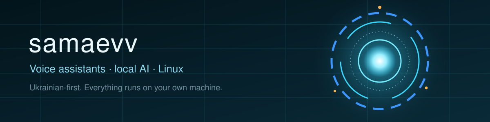

<p align="center"></p>

<h3 align="center">Привіт! 👋 Я розробник з України: роблю спільноту для програмістів і голосового асистента, який працює на твоєму комп'ютері</h3>

<p align="center">
  
</p>

---

## 🛠️ Стек

<p>
  
  
  
  
  
  
  
  
</p>

---

## 🌸 Code Bloom · спільнота для українських програмістів

**Code Bloom** (перша українська соцмережа для програмістів): місце, де можна спілкуватись, ділитись знаннями й розвиватись разом.

- 💬 **Чат** із кімнатами (загальний, Python, JavaScript, дизайн, допомога, офтоп): інкрементальна синхронізація, чернетки, повторне надсилання без дублів
- 🗂️ **Форум** з темами й відповідями, профілі, ролі та адмін-панель
- 📱 **Android-додаток** на Capacitor: той самий код, що й сайт; токен зберігається в Android Keystore
- ⚙️ **Бекенд:** FastAPI + MongoDB, розгорнутий на Render
- 🎬 **Промо-відео:** серія вертикальних рекламних роликів, зібраних на Remotion

<p>
  <a href="https://code-bloom.org"></a>
  <a href="https://t.me/codebloomcomunity"></a>
</p>

---

## 🎙️ [samaevv-assistant](https://github.com/samaevv/samaevv-assistant) · український голосовий асистент «Джарвіс»

Асистент для Linux: слухає слово активації, розуміє вільні фрази, відкриває програми, керує вікнами, шукає музику, веде нотатки, дає поради. Власні команди створюються **з опису словами**.

| | |
|---|---|
| 🎙️ **Слух** | розпізнавання мови на твоєму ПК (Whisper), без хмари |
| 🧠 **Мозок** | безкоштовна локальна модель (Ollama + Gemma) або Claude / Codex |
| 🧩 **Плагіни** | 30+ вмінь: погода, Obsidian, радіо, нагадування, OCR, жести камерою |
| 🖥️ **Центр керування** | у браузері, на будь-якій системі |
| 🔒 **Приватність** | усе локально, дані не залишають комп'ютер |

```bash
curl -fsSL https://raw.githubusercontent.com/samaevv/samaevv-assistant/main/get.sh | bash
```

> Стадія: бета. Найкраще перевірено на Omarchy (Arch + Hyprland); інші системи підтримані, але чекають на тестувальників.

---

## 🌱 Зараз вчу й роблю
- Windows-версію асистента
- Кращі українські голоси та розуміння вільних фраз
- Розвиток Code Bloom

---

<p align="center"><i>Якщо проєкт тобі корисний, постав ⭐ репозиторію: це найкраща підтримка.</i></p>
